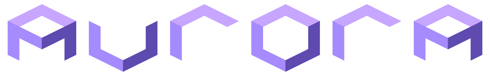

  

 

This is MH3's maintained Aurora copy. It provides SDL3 application services,
OpenGL ES 3.0 on Linux and native GXM on Vita. The game thread records frame
packets through typed native geometry/material/texture APIs and a render
thread owns the graphics context. GX API and FIFO compatibility entry points
deliberately panic. Dawn/WebGPU, Vulkan,
D3D12 and Metal are not build targets in this checkout.

See [GX replacement](../docs/optimizations/rendering/gx-replacement.md) for the
current renderer. Use the repository's build scripts (see the
[README](../README.md)); upstream Aurora build instructions describe a
different renderer.

Aurora originated as a source-level GameCube/Wii compatibility layer, developed
for [Metaforce](https://github.com/AxioDL/metaforce). Its retained license and
services do not imply current support for every upstream platform or GX path.

### License

Aurora is licensed under the [MIT License](LICENSE).
